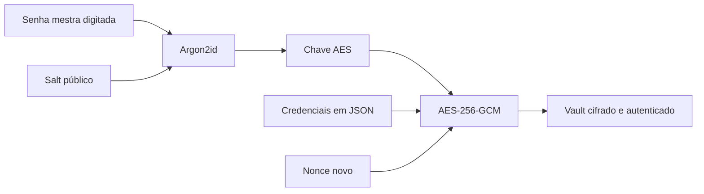
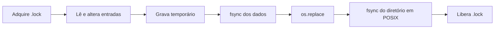

# Demonstração — Pass Vault

## Projeto e problema

O Pass Vault é um gerenciador local de credenciais por linha de comando. Ele permite
recuperar senhas de serviços quando necessário, mantendo as entradas criptografadas
em um arquivo. O cenário principal é o roubo de uma cópia desse arquivo: sem a senha
mestra, o atacante precisa tentar adivinhá-la para derivar a chave de abertura.

## O que foi implementado

Os comandos `init`, `add`, `get`, `list`, `delete`, `gen` e `change-password` formam a
base do programa. Os quatro desafios do MVP também estão presentes: `search`,
`count`, registro de último uso no `get` e senha ocultada por padrão, revelada com
`get --show`.

A senha mestra passa por Argon2id para produzir a chave. AES-256-GCM cifra as
entradas e verifica sua integridade. A cada gravação, o programa usa um nonce novo,
salva primeiro em um arquivo temporário, sincroniza os dados e substitui o arquivo
anterior. Um arquivo `.lock` serializa processos que acessam o mesmo vault.

## Resultados e validação

- `just test`: 82 testes aprovados no Windows; dois testes de permissões POSIX são
  ignorados nessa plataforma.
- `just lint`: Ruff, mypy e Pylint passaram.
- Os testes incluem abertura com senha incorreta, adulteração do arquivo, rotação
  da senha mestra, bloqueio entre processos e comportamento dos comandos da CLI.

## Decisões e limites

`argparse` mantém a interface pequena e sem dependências adicionais para a CLI.
Argon2id dificulta tentativas de senha mestra feitas sobre um arquivo roubado; ele
não compensa uma senha mestra fraca. A cifra autenticada rejeita alterações nos
dados, enquanto bloqueio e gravação atômica tratam concorrência e interrupções
durante o salvamento. São problemas diferentes, por isso exigem mecanismos
diferentes.

O projeto não protege contra keyloggers, observação da tela durante `get --show`
ou leitura da memória de um processo desbloqueado. No Windows, as permissões
dependem das ACLs herdadas do diretório e não há sincronização do diretório pela
biblioteca padrão. Esta é uma implementação educacional, não um substituto para
um gerenciador de senhas auditado.

## Conclusão

O exercício mostrou por que criptografar o conteúdo é apenas parte do problema:
é preciso também derivar bem a chave, autenticar o arquivo, evitar perda de dados
na gravação e definir explicitamente as ameaças cobertas. Um passo futuro seria
comparar essas decisões com as de um gerenciador de senhas auditado.

## Vídeo

**Link da demonstração:** adicione aqui o link do vídeo após a gravação.

### Diagrama 1 — abertura e proteção (mostrar na arquitetura)

### Diagrama 2 — salvamento (mostrar nas decisões técnicas)

### Roteiro de gravação (6–8 minutos)

1. **Contexto (45 s):** apresente o problema de guardar senhas recuperáveis e o
   cenário de roubo do arquivo.
2. **Arquitetura (60 s):** mostre `main.py`, `vault.py` e `crypto.py`. Explique:
   senha mestra + salt → Argon2id → chave; entradas + chave + nonce → AES-GCM →
   arquivo criptografado.
3. **Execução (3–4 min):** use um vault de demonstração e credenciais fictícias.
   Rode `init`, `add github --generate`, `list`, `search git`, `count`, `get github`
   e `get github --show`. Mostre o JSON externo: ele contém salt, parâmetros,
   nonce e ciphertext, mas não o nome nem a senha da entrada em texto claro.
4. **Decisões (60 s):** explique por que Argon2id, AES-GCM e gravação
   atômica/bloqueio resolvem riscos distintos. Diga o que o projeto não protege.
5. **Validação e fechamento (60 s):** rode `just test` e `just lint`, mostre os
   resultados e conclua com o principal aprendizado.

Use uma senha mestra criada só para a gravação. Para isolar o exemplo, coloque
`--vault .demo/vault.json` **antes** de cada comando `pv`. Se esse arquivo já
existir, escolha outro caminho para que `init` crie um vault novo.
